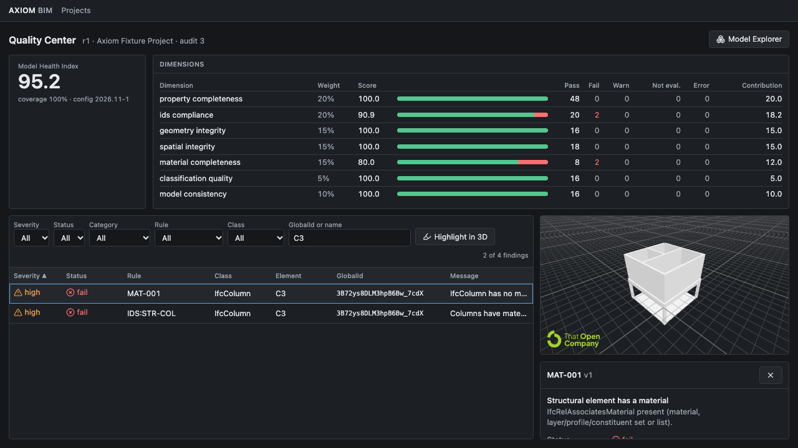
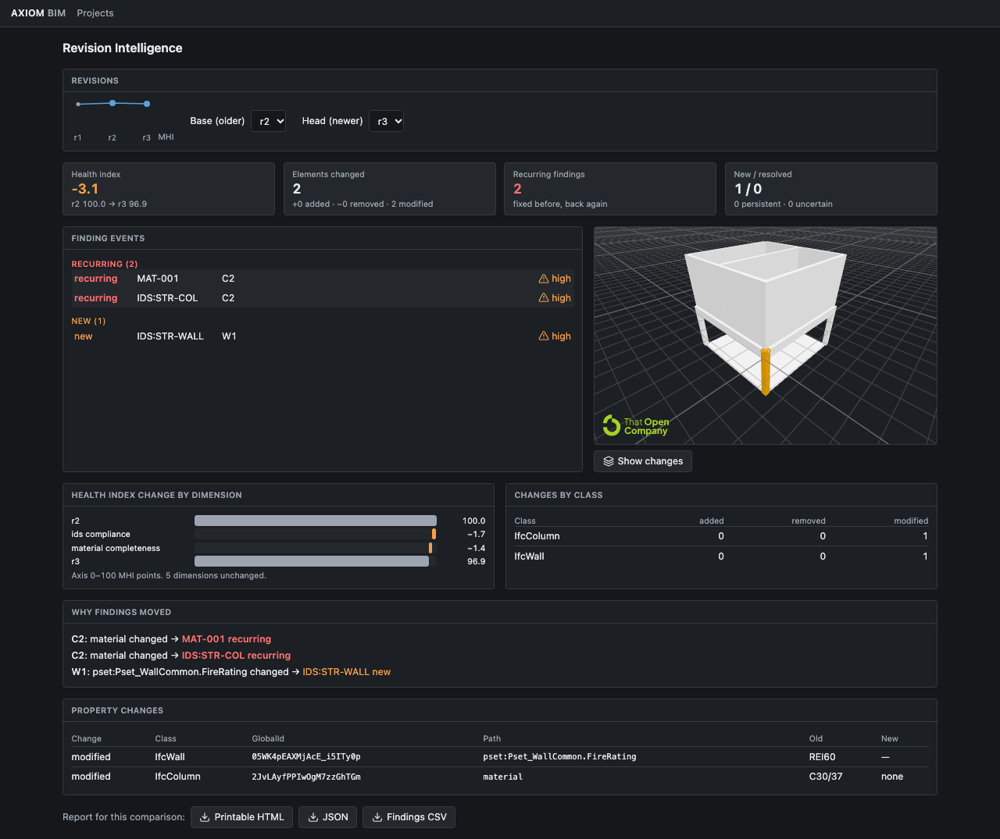
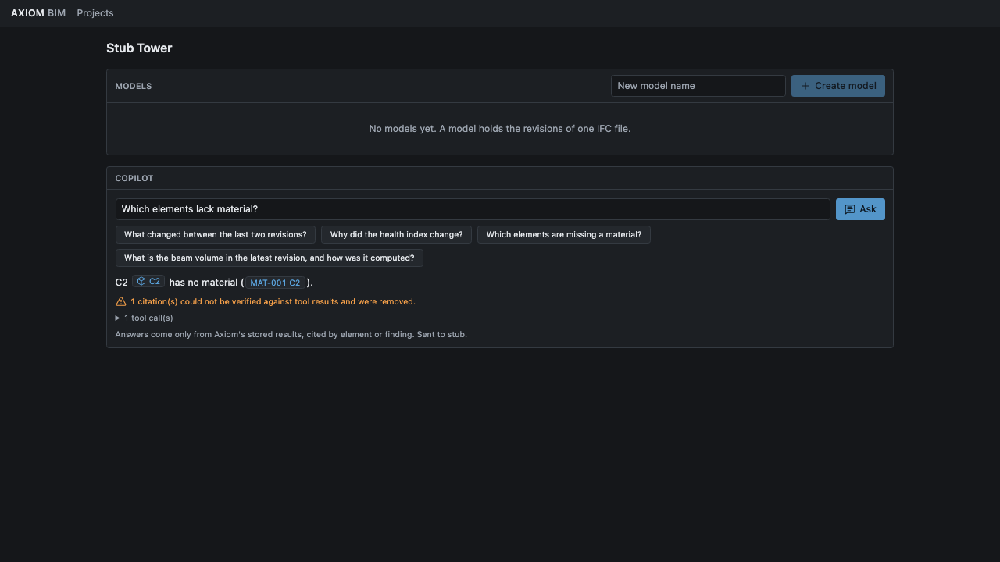

# Axiom BIM

[](https://github.com/AyanbergenSaduakassov07/Axion-Bim/actions/workflows/ci.yml)
[](LICENSE)

Axiom BIM is a local-first quality and revision analysis tool for IFC building models. It turns IFC files into searchable model data, checks them against IDS requirements and deterministic rules, and makes model changes and information gaps easier to review.

The project includes a Python engine and CLI, a FastAPI service, and a React web app with an interactive 3D viewer. The Model Health Index (MHI) summarizes information completeness; it is not a structural safety score.

## What it does

- Extracts IFC elements, properties, materials, classifications, quantities, units, and spatial relationships into revision snapshots.
- Runs built-in checks and IDS specifications through IfcTester, then records findings with evidence and reproducibility metadata.
- Scores model information quality with a versioned MHI configuration.
- Compares revisions by IFC `GlobalId` and tracks findings as new, resolved, persistent, recurring, changed, or uncertain.
- Compares reported quantities with geometry-derived volumes, keeping quantity methods separate.
- Provides a 3D model explorer, quality findings, revision history, quantity summaries, and printable reports.
- Offers an optional read-only AI copilot. Citation tokens are checked against tool output from that response.

## Screenshots

### Quality findings with 3D highlighting



### Revision comparison and MHI waterfall



### Copilot with citations



## Quickstart

### Run locally

Requirements: Python 3.12, [uv](https://docs.astral.sh/uv/), and Node.js 22 or newer.

```bash
# From the repository root
uv sync
uv run axiom serve --port 8000
```

In a second terminal:

```bash
cd apps/web
npm ci
npm run dev
```

Open [http://localhost:5173](http://localhost:5173). The web development server proxies API requests to `http://127.0.0.1:8000`. By default, Axiom stores its SQLite database and uploaded files in `data/`; set `AXIOM_DATA_DIR` to choose another location.

### Run with Docker Compose

```bash
docker compose up --build
```

Open [http://localhost:3000](http://localhost:3000). The API is also available at [http://localhost:8000](http://localhost:8000). Compose stores data in the `axiom-data` volume and publishes both services on loopback for local use.

## Try the CLI

Generate the deterministic demo IFCs and inspect them:

```bash
uv run python scripts/e2e_fixtures.py /tmp/axiom-models
uv run axiom inspect /tmp/axiom-models/rev1.ifc
uv run axiom audit /tmp/axiom-models/rev1.ifc --ids examples/ids/structural-basic.ids
uv run axiom compare \
  /tmp/axiom-models/rev1.ifc \
  /tmp/axiom-models/rev2.ifc \
  /tmp/axiom-models/rev3.ifc \
  --ids examples/ids/structural-basic.ids
```

`axiom audit` prints the audit ID. Use that value to render a report:

```bash
uv run axiom report <audit-id> --format html --out report.html
```

The demo revisions show a missing material issue being fixed and later reappearing. Axiom marks the reappearing finding as recurring. See the [demo script](docs/demo-script.md) and [fixture source and license notes](examples/models/SOURCES.md).

## Optional AI copilot

The core inspection, audit, comparison, and viewer features work without an AI provider. To enable the copilot, set one provider key in the environment before starting the API:

```bash
export ANTHROPIC_API_KEY=your-key
# Or use an OpenRouter key:
export OPENROUTER_API_KEY=your-key
```

Anthropic is used when both keys are set. The default Anthropic model is `claude-sonnet-5-5`; set `AXIOM_COPILOT_MODEL` to override it. Without a key, the copilot panel is hidden and its API endpoint returns `503 copilot_unavailable`. Keys stay on the server and are not sent to the browser.

The copilot calls read-only Axiom tools. Its element and finding citation tokens are accepted only when those tokens appeared in tool output from the same response. This check validates citations; it does not certify every uncited statement as correct.

## Architecture

```text
React + Vite web app ── REST/OpenAPI ── FastAPI
                                          │
CLI ─────────────────────────────────────┤
                                          ▼
                              services → repositories → SQLite
                                          ▲
IFC file → isolated job runner → extract → audit → score → compare
```

The API coordinates jobs and services. IFC parsing and geometry work run in supervised subprocesses with time and memory limits. The database and content-addressed IFC files are local by default. The browser viewer renders models and links viewer elements to backend `GlobalId` values.

## Checks

Run the backend checks from the repository root:

```bash
uv run ruff check .
uv run ruff format --check .
uv run pytest -q
```

Run the web checks from `apps/web`:

```bash
npm ci
npm run typecheck
npm run build
npm test
npx playwright install chromium
npx playwright test
```

Backend benchmarks on public CC-BY models: `uv run python benchmarks/run.py` → [benchmarks/RESULTS.md](benchmarks/RESULTS.md).
The latest release walkthrough is in [docs/release-check.md](docs/release-check.md).

## Scope and deployment

Axiom is designed for local, single-user workflows and does not include authentication or multi-tenant access controls. Keep the API on a trusted network; add authentication and rate limiting before exposing it to other users. Revision matching uses `GlobalId`, so re-exported elements with new IDs appear as removed and added. Clash detection and structural capacity or code-compliance calculations are outside the current scope.

Read the full [limitations and scope](docs/limitations.md) before using results in a project workflow.

## License

Axiom BIM is licensed under the [MIT License](LICENSE). See [NOTICE](NOTICE) for third-party licenses and attribution.
