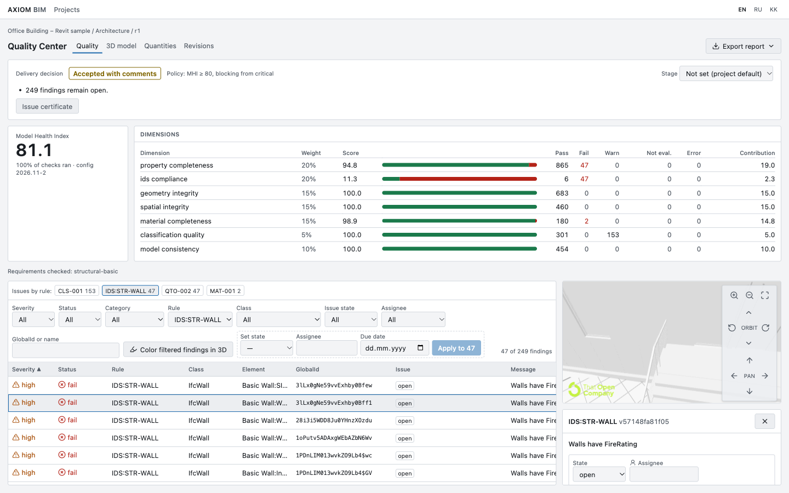
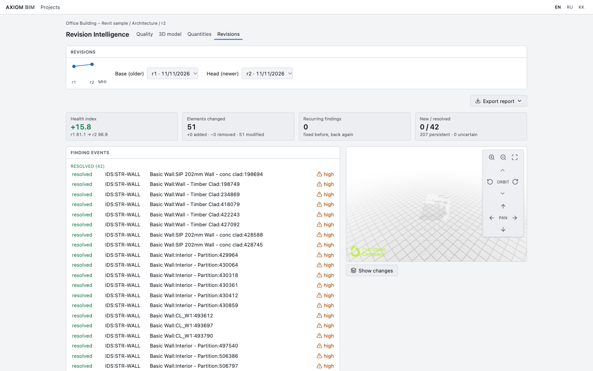
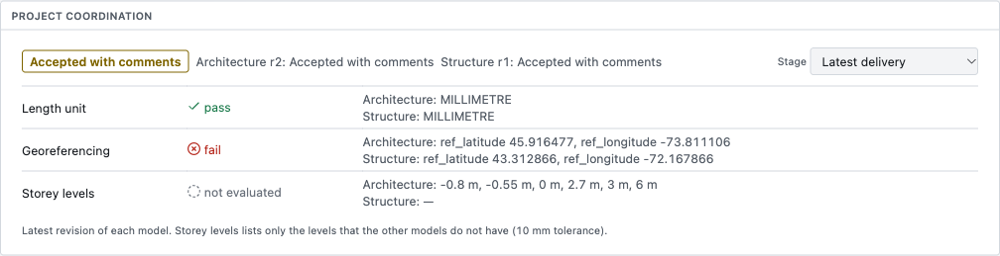
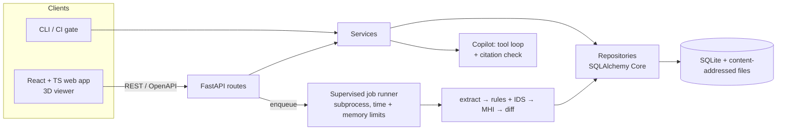

# Axiom BIM

[](https://github.com/AyanbergenSaduakassov07/Axion-Bim/actions/workflows/ci.yml)
[](LICENSE)


**Quality control for building information models.** Axiom checks an IFC model against the client's requirements,
says whether a delivery can be accepted, shows what changed since the last revision, and points to every
problem element in 3D. Each result comes with its evidence.

On a real buildingSMART revision pair it catches the architect's fix: 42 of 47 walls gained the required
`FireRating`. The health index rises from 81.1 to 96.9, and it names the five walls still missing it.



## Why

On a construction project, design firms hand over IFC models at every stage. Someone on the receiving side has
to check them before the models feed quantities, coordination and drawings. Today that check is mostly manual,
or it runs in desktop tools that cost thousands per seat. Axiom does it in a browser or from a CI job and gives
reproducible answers:

- **Can we accept this delivery?** Accepted, accepted with comments, or rejected, under a per-project and
  per-stage policy. The decision can be frozen as a certificate that hashes the file, ruleset and IDS.
- **What is wrong, exactly?** Every finding carries the element's GlobalId, the rule id and version, the
  expected and actual values, and the evidence.
- **What changed since last time?** Elements are matched across revisions by GlobalId. Each finding is tracked
  as `new`, `resolved`, `persistent`, `recurring`, `changed` or `uncertain`.

Axiom measures *information quality*. It does not assess structural safety, and it never claims to.

## Tested on real models

The tool ran end to end on **15 public sample models**. The largest has
17,553 elements; the files span IFC2X3, IFC4 and IFC4X3, 2–49 MB. It found no crashes. Each model ran the audit,
the geometry pass and the BCF export in **0.9–24.5 s**, with peak memory **under 2.7 GB**.
Full tables: [heavy models](benchmarks/RESULTS-heavy.md) and [popular samples](benchmarks/RESULTS-popular.md).

A [civil-engineer walkthrough](docs/user-test.md) of the web app on the Revit ARC/STR samples found real defects
*in the models*:
- Revit wrote wall volumes twice, once in mm³ under a declared m³ unit: off by 10⁹.
- The architectural and structural models are georeferenced about 290 km apart.

It also found three bugs *in Axiom*, fixed the same day ([D-49](docs/DECISIONS.md)).

| | |
|---|---|
|  |  |
| Revision comparison: 42 findings resolved, MHI +15.8 | Coordination: units agree, georeferencing does not |

## Features

| Area | What it does |
|---|---|
| **Extraction** | Elements, property sets, materials, classifications, quantities, units and spatial structure into versioned revision snapshots |
| **Validation** | IDS 1.0 via IfcTester plus 10 deterministic rules: materials, classification, spatial containment, geometry, placement outliers, quantity plausibility, and declared vs geometric volume |
| **Scoring** | Model Health Index (MHI) over seven weighted dimensions, with a versioned config. Unevaluated checks lower coverage, never the score ([formula](docs/PLAN.md)) |
| **Delivery gate** | Per-project, per-stage policy (concept → as-built) and a hash-frozen certificate. `axiom audit --gate` fails a CI job when a delivery is rejected |
| **Revisions** | GlobalId diff, finding event history, MHI waterfall, recurring-issue detection |
| **Issues** | State, assignee, due date, notes, waivers, full change history, Markdown digest per assignee |
| **Exchange** | BCF 3.0 export: stable topic GUIDs across revisions and issue history as comments, so findings open in BIMcollab, Solibri and Revit. Printable HTML reports and CSV quantities |
| **3D viewer** | Browser viewer (ThatOpen / web-ifc): a click on a finding focuses the element, findings can be coloured, models are cached locally |
| **Coordination** | Latest delivery of every discipline side by side: units, georeferencing, storey levels |
| **Copilot** (optional) | Read-only assistant in English, Russian and Kazakh. It answers through tools over stored results, and a post-check strips every element id it did not see in a tool result |

## Architecture



Design rules the code enforces ([all 49 decisions](docs/DECISIONS.md)):
- **The backend is the source of truth.** The viewer renders and the LLM explains; neither computes an
  engineering result.
- **Strict layering.** Routes → services → repositories; routes never touch the database, and the CLI uses
  the same services.
- **IFC never runs inside a request.** Parsing and geometry run in subprocesses with time and memory limits,
  so a malformed 50 MB file cannot take down the API.
- **No false passes.** Statuses are `pass | fail | warning | not_applicable | not_evaluated | error`. A check
  that could not run is never reported as passed.
- **Reproducible findings.** Identity keys are stable across revisions, and every finding records the rule
  version and config it was produced with.

## Engineering quality

- **Tests:** 267 passing backend tests (pytest) on generated IFC fixtures with golden `expected.yaml` results, plus
  unit tests and Playwright end-to-end tests for the web app. CI runs both on every push.
- **Copilot safety:** a live evaluation suite (`axiom.copilot.eval`), prompt-injection fixtures and a citation
  post-check. Model output never reaches the database.
- **Security review:** Host allowlist (DNS rebinding), Origin check on writes, XML entity expansion blocked in
  IDS, a strict CSP, non-root containers, and rate limits on the copilot ([release check](docs/release-check.md)).
- **Tooling:** uv, ruff, Alembic migrations, typed OpenAPI client generated for the frontend.

## Quickstart

Requirements: Python 3.12, [uv](https://docs.astral.sh/uv/), Node.js 22+.

```bash
uv sync
uv run axiom serve --port 8000            # API + job runner; data in ./data (AXIOM_DATA_DIR to change)
cd apps/web && npm ci && npm run dev      # http://localhost:5173
```

Or with Docker: `docker compose up --build`, then open http://localhost:3000.

### Demo

The local `demo/` folder (gitignored, not part of the repository) holds the sample models and a database
preloaded with the walkthrough project:

```bash
AXIOM_DATA_DIR=demo/data uv run axiom serve --port 8000
cd apps/web && npm run dev                # open "Office Building – Revit sample"
```

The models in `demo/models/` can be uploaded live. The best story is `Ifc4_Revit_ARC.ifc`, then
`Ifc4_Revit_ARC_FireRatingAdded.ifc` as revision 2, with `examples/ids/structural-basic.ids`. Without the
folder, `uv run python scripts/e2e_fixtures.py /tmp/axiom-models` generates a small deterministic set. The
[demo script](docs/demo-script.md) walks through it.

### CLI

```bash
uv run axiom audit model.ifc --ids requirements.ids --gate      # exit 1 unless the delivery is accepted
uv run axiom audit model.ifc --geometry                         # adds declared-vs-geometric volume check
uv run axiom compare rev1.ifc rev2.ifc rev3.ifc --ids requirements.ids
uv run axiom report <audit-id> --format bcf --out issues.bcf    # or --format html
uv run axiom quantities model.ifc --by storey --against previous.ifc
uv run axiom digest --project "Tower A" --out digest.md         # open issues per assignee, overdue first
```

### Copilot (optional)

Set `ANTHROPIC_API_KEY` (default model `claude-sonnet-5-5`) or `OPENROUTER_API_KEY` before starting the API.
Without a key the panel is hidden and everything else works. Keys stay on the server.

## Checks

```bash
uv run ruff check . && uv run ruff format --check . && uv run pytest -q
cd apps/web && npm run typecheck && npm test && npm run build && npx playwright test
uv run python benchmarks/run.py --local <folder-of-ifc-files>   # benchmark your own models
```

## Scope

Axiom is local-first and single-user: there is no authentication, so keep it on a trusted network. Revision
matching relies on GlobalId, so a re-export that renews ids shows as removed plus added. The tool does no clash
detection, no structural capacity checks and no code-compliance calculations. Read the
[limitations](docs/limitations.md) before using results on a project.

## Stack

Python 3.12 · ifcopenshell / IfcTester 0.9 · FastAPI · Pydantic v2 · SQLAlchemy Core + Alembic · SQLite ·
React · TypeScript · Vite · Tailwind · TanStack Query · ThatOpen Components / web-ifc · Playwright · Docker

## License

MIT, see [LICENSE](LICENSE). Third-party notices are in [NOTICE](NOTICE).
